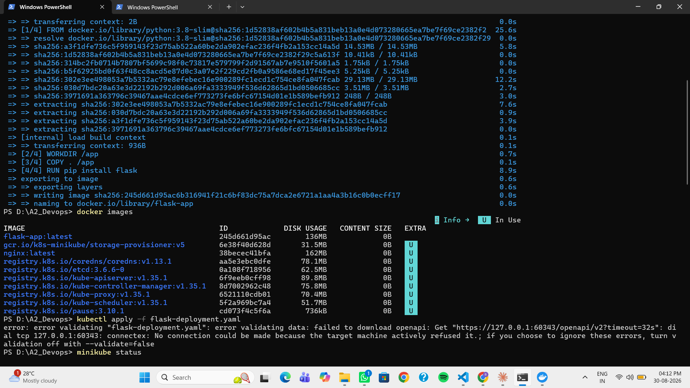
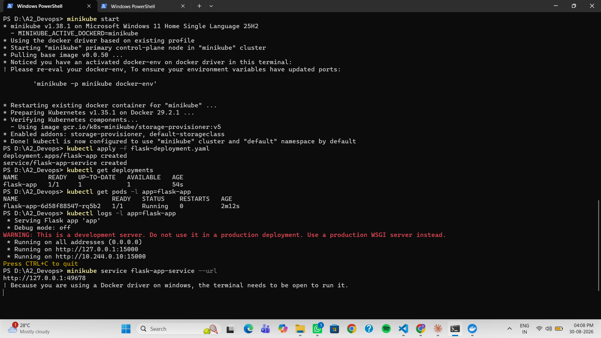
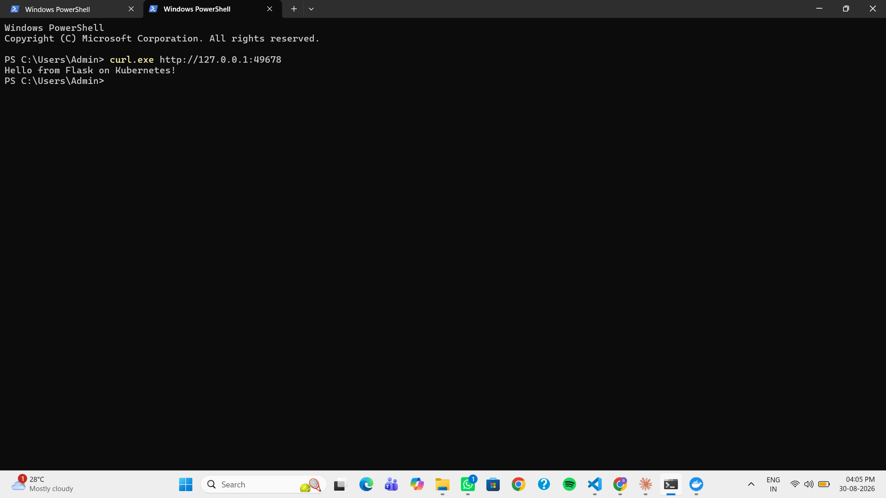

# 🐍 Deploy a Flask App on Minikube using kubectl & YAML

## 🎯 Objective

Learn Kubernetes basics with Minikube by building a Python **Flask** app, containerizing it with Docker, and deploying it to a single-node Kubernetes cluster using a YAML manifest — then accessing it through a Service.

## 🛠️ Environment

- **OS:** Windows 11 (commands run in PowerShell)
- **Driver:** Docker Desktop
- **Cluster:** Minikube v1.38.1
- **CLI:** kubectl

## 📁 Files

| File | Purpose |
|------|---------|
| `app.py` | Minimal Flask app that returns "Hello from Flask on Kubernetes!" on port 15000 |
| `Dockerfile` | Builds a `python:3.8-slim` image, installs Flask, runs `app.py` |
| `flask-deployment.yaml` | Kubernetes **Deployment** (1 replica) + **NodePort Service** |

## 📋 Steps Performed

**1. Start the cluster**
```powershell
minikube start
```

**2. Point the Docker CLI at Minikube's Docker daemon**
(Windows/PowerShell equivalent of `eval $(minikube docker-env)`)
```powershell
& minikube docker-env --shell powershell | Invoke-Expression
```
This makes the next build land *inside* Minikube, so Kubernetes can use the local image (`imagePullPolicy: Never`).

**3. Build the image**
```powershell
docker build -t flask-app .
docker images        # confirms flask-app:latest exists
```

**4. Deploy the app + service**
```powershell
kubectl apply -f flask-deployment.yaml
# deployment.apps/flask-app created
# service/flask-app-service created
```

**5. Verify the deployment and pod**
```powershell
kubectl get deployments
kubectl get pods -l app=flask-app     # STATUS: Running
kubectl logs -l app=flask-app         # * Running on http://0.0.0.0:15000
```

**6. Access the app**
```powershell
minikube service flask-app-service --url
# http://127.0.0.1:49678   (keep this window open)
```
In a second PowerShell window:
```powershell
curl.exe http://127.0.0.1:49678
# Hello from Flask on Kubernetes!
```

## 📸 Output

**1. Building the image inside Minikube:**



**2. Deployment, pod, and logs:**



**3. Accessing the Flask app — success:**



## 🧠 Key Concepts

- **`imagePullPolicy: Never`** — Kubernetes uses the **local** image built inside Minikube instead of pulling from a remote registry like Docker Hub.
- **Deployment** — manages the desired number of Pod replicas and handles rolling updates.
- **Service (NodePort)** — gives the Pods a stable, externally reachable endpoint.
- **`port` vs `targetPort`** — `port` is the port the Service exposes; `targetPort` is the port the container (Flask) actually listens on. Request flow: **client → Service (port 15000) → container (targetPort 15000)**.
- **Docker driver on Windows** — the `minikube service --url` terminal must stay open to keep the tunnel to the Service alive.

## ✅ Result

Successfully built a Flask container image inside Minikube, deployed it as a Kubernetes Deployment, exposed it through a NodePort Service, and received `Hello from Flask on Kubernetes!` — completing the exercise.
