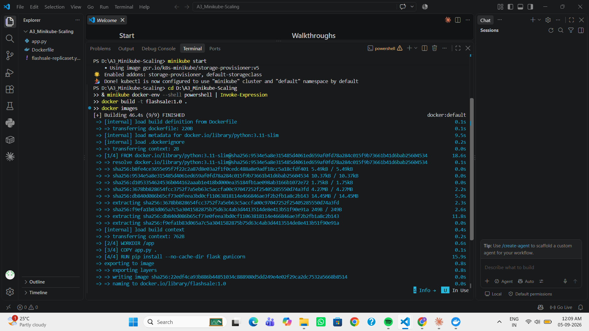
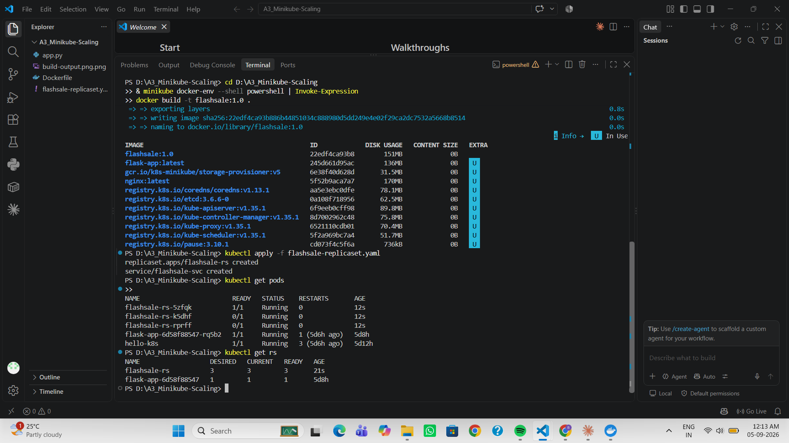
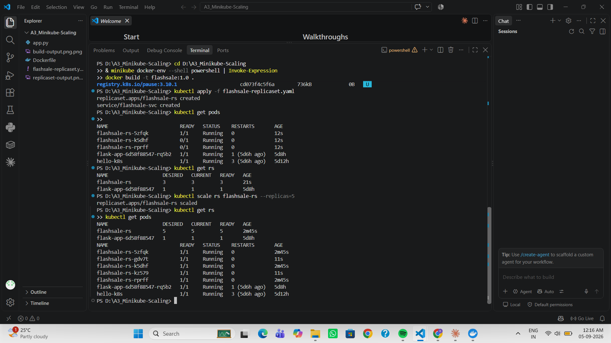
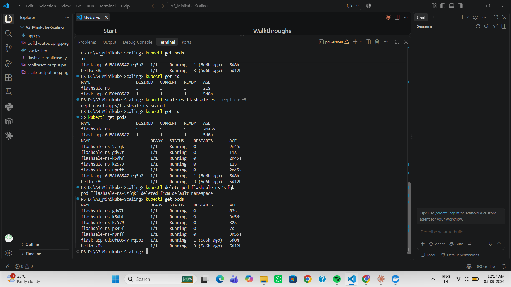

# ⚡ Scaling a Flask App on Minikube using ReplicaSets

## 🎯 Objective

- Understand **ReplicaSets** and **Pods** in Kubernetes
- Scale a Flask app deployment up and down
- Observe pod distribution and **self-healing**

## 🛒 Real-World Use Case: E-commerce Flash Sale

During a flash sale (like Big Billion Days or Prime Day), a Flask service that normally handles ~100 requests/min can suddenly face 10,000/min. A single Pod would crash under the load. With a **ReplicaSet**, Kubernetes runs multiple identical Pods and distributes traffic among them — scaling out during the spike and back down afterwards, exactly how Netflix, YouTube, and Swiggy handle peak traffic.

## 🛠️ Environment

- **OS:** Windows 11 (PowerShell)
- **Driver:** Docker Desktop
- **Cluster:** Minikube v1.38.1 (single node)

## 📁 Files

| File | Purpose |
|------|---------|
| `app.py` | Flask "flash sale" app — `/` welcome, `/buy` checkout (shows which Pod served it), `/health` probe endpoint |
| `Dockerfile` | Builds a `python:3.11-slim` image, runs the app with gunicorn on port 5000 |
| `flashsale-replicaset.yaml` | A **ReplicaSet** (3 replicas, with readiness/liveness probes + resource limits) and a **ClusterIP Service** |

## 📋 Steps Performed

**1. Build the image inside Minikube**
```powershell
minikube start
& minikube docker-env --shell powershell | Invoke-Expression   # Windows equivalent of eval $(minikube docker-env)
docker build -t flashsale:1.0 .
docker images        # confirms flashsale:1.0
```
> The image is tagged `flashsale:1.0` and the YAML uses `imagePullPolicy: Never`, so Kubernetes uses the **local** image built inside Minikube — no Docker Hub push needed.

**2. Apply the ReplicaSet + Service**
```powershell
kubectl apply -f flashsale-replicaset.yaml
# replicaset.apps/flashsale-rs created
# service/flashsale-svc created
```

**3. Verify — 3 pods running**
```powershell
kubectl get pods       # 3 x flashsale-rs-xxxxx, STATUS Running
kubectl get rs         # flashsale-rs  DESIRED 3  CURRENT 3  READY 3
```

**4. Scale up to 5 replicas**
```powershell
kubectl scale rs flashsale-rs --replicas=5
kubectl get rs         # flashsale-rs  5  5  5
kubectl get pods       # now 5 pods
```

**5. Test self-healing — delete a pod**
```powershell
kubectl delete pod <flashsale-rs-podname>
kubectl get pods       # still 5 pods — one has a very small AGE (the auto-created replacement)
```

## 📸 Output

**1. Image built inside Minikube (`flashsale:1.0`):**



**2. ReplicaSet applied — 3 pods running (3/3/3):**



**3. Scaled to 5 replicas:**



**4. Self-healing — deleted a pod, ReplicaSet recreated it to keep 5:**



## 🧠 Key Concepts & Observations

- **Pod** — an identical worker running the app; scaling means creating clones.
- **ReplicaSet** — continuously ensures the desired number of Pods are running.
- **Self-healing** — if a Pod is deleted or fails, the ReplicaSet automatically creates a new one, so users see no downtime.
- **Scaling** — `kubectl scale` changes the replica count; Kubernetes adds/removes Pods to match.
- **Readiness/Liveness probes** — hit `/health` to know when a Pod is ready to serve and whether it's still alive.
- **Efficiency** — add Pods when demand spikes, remove them when it drops, instead of over-provisioning servers.

## ❓ Quick Q&A

1. **Initial replicas?** 3
2. **Pods after applying?** 3
3. **After scaling to 5?** Kubernetes creates 2 more pods → 5 running.
4. **After deleting a pod?** Kubernetes creates a replacement to maintain 5.
5. **How is the desired count maintained?** The ReplicaSet constantly compares running vs desired and adds/removes pods.
6. **Nodes running?** 1 (single-node Minikube) — all pods run on that node.

## ✅ Result

Built a Flask app image inside Minikube, deployed it via a ReplicaSet (3 pods), scaled it to 5, and confirmed Kubernetes self-heals by recreating a deleted pod — demonstrating scaling and resiliency on a single-node cluster.
